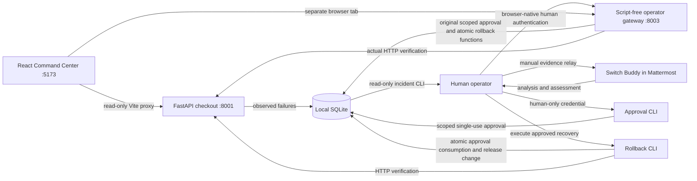

# DeployGuard AI

A human–AI incident-response demonstration for the Flip the Switch Hackathon 2026.
A local checkout API transitions from healthy `v1.0.0` to deliberately broken
`v1.1.0`, records actual failed requests, and recovers only through a persisted,
scoped, single-use human approval and verified rollback.

**Current demonstration: AI-assisted analysis with human-executed recovery, not
autonomous agent recovery.** The operator manually supplied incident evidence to
Switch Buddy in Mattermost. Buddy analyzed it and produced a final incident-resolution
assessment after the human executed recovery. The dedicated Investigator and Recovery
agents are registered but remain stopped. Their tool integration is planned.

### Implemented and verified

| Capability | Evidence and status |
| --- | --- |
| Checkout failure and incident evidence | Live-tested: `v1.1.0` checkout fails and stores actual exception/request evidence. The faulty release is a deliberate local simulation. |
| Human approval and rollback | Live-tested: approval is required before human-executed rollback to `v1.0.0`. |
| Recovery verification | Live-tested: all five checks pass: `version`, `health`, `checkout`, `audit`, `persisted_deployment`. |
| Switch/Mattermost analysis | Live-tested by the operator: manually supplied evidence was analyzed by Switch Buddy, which also supplied the final resolution assessment. |
| Backend regression suite | **98 automated tests passed**, including all original 60; coverage includes the original approval invariants, read-only polling, native authentication, CSRF, session isolation, gateway concurrency, and verification retry. See [test results](docs/test-results.md). |
| Incident Command Center | Six React/TypeScript pages with real API data, themes, investigation briefs, audit history, and protected browser recovery. See [website-first demo](docs/dashboard.md). |
| Browser recovery | Real-HTTP Chromium testing covers automatic failure detection, browser-native human authentication, scoped approval, explicit rollback, five checks, automatic dashboard refresh, and audit. Tests use isolated storage and synthetic credentials; the real human credential was not accessed. |
| Dedicated agent workflow | Prepared instructions and JSON CLIs; Investigator and Recovery agents remain stopped. Automated handoff, evidence ingestion, and agent-executed recovery are unverified/planned. |

Implemented features also include SQLite persistence, incident deduplication,
read-only investigation, explicitly recorded investigation reports, an allowlisted
atomic rollback, audit history, a staged operator demo, and the Incident Command Center.
Recovery is human-operated through a separate localhost browser operator console or
the existing CLI. No real infrastructure recovery adapter is implemented. See the
[hackathon submission](docs/submission.md) and [operator security boundary](docs/operator-security.md).

### Run the Incident Command Center

Start or restart the updated backend in one terminal:

```bash
cd /home/awnish/projects/deployguard-ai
env -u DEPLOYGUARD_HUMAN_SECRET -u DEPLOYGUARD_DB .venv/bin/python -m uvicorn app.main:app --host 127.0.0.1 --port 8001
```

Start the protected operator gateway in a second terminal. It never loads a human
credential from the environment; sign-in happens through the browser-owned dialog:

```bash
cd /home/awnish/projects/deployguard-ai
env -u DEPLOYGUARD_HUMAN_SECRET -u DEPLOYGUARD_DB .venv/bin/python -m uvicorn app.operator:app --host 127.0.0.1 --port 8003 --workers 1 --no-access-log --no-proxy-headers
```

Start the frontend in a third terminal (Node 22.12+ or Node 24 recommended):

```bash
cd /home/awnish/projects/deployguard-ai/frontend
npm ci
env -u DEPLOYGUARD_HUMAN_SECRET npm run dev
```

Open **http://127.0.0.1:5173**. The dashboard never probes `/health` or posts to
`/checkout`. It refreshes persisted data every five seconds by default. The separate
gateway records one real observation per newly activated, unobserved release. Settings
provides theme, polling, timezone, accessibility, and Mattermost room preferences.
During the demo, only `tools/reset_demo.py` fault activation needs the terminal.
Authenticate, issue approval, explicitly execute, and review checks in the protected
browser console linked from Recovery Center. Username: **operator**; enter the existing
human credential only into the browser's native dialog. The gateway is a trusted-machine,
loopback HTTP demo, not enterprise authentication. Use a private window and close it
afterward. See [setup, demo instructions, file inventory, and limitations](docs/dashboard.md).

## Architecture

FastAPI serves the checkout API on **127.0.0.1:8001**. The API and local tools share
`evidence/deployguard.sqlite3`. Only two release behaviors are available. Health and
checkout record observed evidence; investigation reads it without probing or writing.
The human approval process uses its own credential. Rollback consumes approval and
changes the release in one transaction, then HTTPX verifies the running service.



### Switch integration

Switch provides the collaboration surface for the demonstrated human–AI workflow.
The human relays observed failure evidence to Switch Buddy, reviews its analysis,
issues approval locally, executes rollback, and relays measured verification results
for the final assessment. Chat messages do not authorize a backend rollback.

The repository supplies specialist-agent instructions and local JSON tools, not an
installed Switch connector or enforced tool isolation. Reproducing Buddy's analysis
requires an existing Switch/Mattermost environment; the backend demo and all tests
run independently. No Switch credentials or configuration are included. The
[integration runbook](docs/agent-integration.md) describes future specialist-agent
setup separately from the demonstrated manual relay.

See [agent integration and required permissions](docs/agent-integration.md),
[staged demo execution](docs/demo.md), [test results](docs/test-results.md),
[architecture and trust boundaries](docs/architecture.md),
[investigator instructions](agents/investigator.md), and
[recovery instructions](agents/recovery.md).

| Endpoint | Behavior |
| --- | --- |
| `GET /health` | 200 healthy or 503 unhealthy; records a real observation |
| `GET /version` | Active version and deployment instance ID |
| `GET /status` | Read-only persisted observations, active deployment, recovery checks, and non-credential approval metadata; never probes service health |
| `POST /checkout` | JSON `{"quantity":1}`; 200 success or 500 release failure |
| `GET /incidents` | Incident history and latest evidence |
| `GET /incidents/{incident_id}` | Incident details; 404 if absent |
| `GET /deployments` | Active deployment and activation history |
| `GET /audit` | Ordered evidence, approval, investigation-report, and recovery events |

Invalid checkout input returns 422. Audit and evidence inspection endpoints do not
issue approvals or execute recovery. The default API documentation is `/docs`.

## Local setup

Run in a Bash terminal. Python 3.12 is required; all dependencies stay in `.venv`.

```bash
cd deployguard-ai
python3.12 -m venv .venv
.venv/bin/python -m pip install --no-cache-dir -r app/requirements.txt
```

Run subsequent commands from the repository root. Use a separate terminal for the
API. No cloud account, AI API key, or Switch connection is needed for the local
backend demonstration. Dependencies have bounded version ranges rather than a
lockfile, so exact resolved versions may differ between installations.

## Reproducible demo

Follow steps A–I below, or use the [staged demo driver](docs/demo.md), which stops
for separately issued human approval. Only a human should run approval and recovery
in the current Switch demonstration. The operator-reported live results above are
separate from automated tests; this preparation does not rerun the credential-bearing
live workflow.

## A. Start healthy

In terminal A, initialize healthy demo state and start the API manually:

```bash
cd /path/to/deployguard-ai
.venv/bin/python tools/reset_demo.py --release v1.0.0
env -u DEPLOYGUARD_HUMAN_SECRET .venv/bin/python -m uvicorn app.main:app --host 127.0.0.1 --port 8001
```

Initialization defaults to healthy. Existing state persists across server restarts.
If a prior session left the service broken, healthy reset is rejected to prevent
an approval bypass: complete the approval/rollback sequence below first. Reset
preserves prior audit history and the human credential verifier.

In terminal B, check healthy behavior:

```bash
cd /path/to/deployguard-ai
curl --noproxy '*' -sS http://127.0.0.1:8001/health
curl --noproxy '*' -sS -H 'Content-Type: application/json' -d '{"quantity":1}' http://127.0.0.1:8001/checkout
```

## B–C. Activate and observe the broken release

```bash
.venv/bin/python tools/reset_demo.py
curl --noproxy '*' -i -H 'Content-Type: application/json' -d '{"quantity":1}' http://127.0.0.1:8001/checkout
curl --noproxy '*' -i http://127.0.0.1:8001/health
```

The checkout response is HTTP 500 and the health response is HTTP 503. Both include
the same active incident ID. The release actually raises a `ValueError` while parsing
its deliberately invalid price configuration. Error evidence includes the exception,
traceback, endpoint, status, and UTC observation time. Repeated failures update the
same incident. Activating a release alone does not invent an incident or health result.

## D. Investigate

Capture the actual incident ID from persisted evidence:

```bash
INCIDENT_ID=$(.venv/bin/python tools/incident.py | .venv/bin/python -c 'import json,sys; print(json.load(sys.stdin)["recent_incidents"][0]["id"])')
.venv/bin/python tools/incident.py --incident-id "$INCIDENT_ID"
curl --noproxy '*' -sS "http://127.0.0.1:8001/incidents/$INCIDENT_ID"
```

`incident.py` outputs JSON with the active deployment, last observed service status,
recent incidents, relevant evidence, and available rollback target. It is strictly
read-only, even for audit storage; it uses no human credential. Stored observations
are timestamped snapshots, not a claim of current live health.

To include the investigation in the final audit narrative, the Investigator's
restricted reporting tool or the operator can explicitly
append a summary through a **separate write command**:

```bash
.venv/bin/python tools/report.py --incident-id "$INCIDENT_ID" --summary 'Observed v1.1.0 checkout HTTP 500 and invalid-price ValueError; propose rollback to v1.0.0.'
```

Reports are labelled untrusted commentary, cannot approve recovery, and should contain
no secrets. Inspection remains read-only; recording a report is a separate,
explicitly permitted write operation. Agent access must be mediated as described
in the [integration runbook](docs/agent-integration.md#before-either-agent-starts).

## E. Demonstrate rejection without approval

```bash
.venv/bin/python tools/rollback.py --incident-id "$INCIDENT_ID"
```

Expected: JSON error `approval_required`, exit code 1, no deployment change, and a
`recovery_rejected` audit event. An agent saying “approved” or inventing an ID has
no effect. Approval must already exist in SQLite and match the exact requested scope.

## F. Human approval

Use a separate human-operated Bash terminal with no agents attached. Before exposing
agent tools, choose and retain a random credential of at least 32 characters in your
password manager. Never store it in source, `.env`, evidence, chat, shell history, or
an agent environment. The commands prompt without echo and pass the credential only
to the approval process. Do not `export` the shell variable.

Initialize the credential verifier **once**, before agents have access:

```bash
cd /path/to/deployguard-ai
read -rsp 'Human credential (32+ random characters): ' DG_HUMAN_SECRET
printf '\n'
DEPLOYGUARD_HUMAN_SECRET="$DG_HUMAN_SECRET" .venv/bin/python tools/approve.py --init
unset DG_HUMAN_SECRET
```

Initialization cannot overwrite an existing verifier. For each recovery, set the
incident ID from the failed response in this human terminal, review the evidence,
and approve exactly rollback to `v1.0.0`:

```bash
read -rp 'Incident ID to approve: ' INCIDENT_ID
read -rsp 'Human credential: ' DG_HUMAN_SECRET
printf '\n'
DEPLOYGUARD_HUMAN_SECRET="$DG_HUMAN_SECRET" .venv/bin/python tools/approve.py --incident-id "$INCIDENT_ID" --target v1.0.0 --ttl-seconds 300
unset DG_HUMAN_SECRET
```

The JSON response contains an `approval_id`, incident, action, exact target, and UTC
expiration. Give the recovery operator/agent only the approval ID and incident ID.
The approval lasts five minutes and can be used once. Allowed TTL is 1–900 seconds.
The API, investigator, and rollback process never require the human credential.

## G. Execute approved rollback

In terminal B (which has no credential), enter the human-issued approval ID:

```bash
read -rp 'Approval ID: ' APPROVAL_ID
env -u DEPLOYGUARD_HUMAN_SECRET .venv/bin/python tools/rollback.py --incident-id "$INCIDENT_ID" --approval-id "$APPROVAL_ID"
```

Only broken `v1.1.0` → known-good `v1.0.0` is allowed. Missing, expired, reused,
wrong-incident, and wrong-target approvals are rejected in application code.
Approval consumption, release switch, incident update, and rollback audit are atomic.

Exit zero with `status: verified` means all recovery checks passed. If the release
switch succeeds but the API cannot be verified, JSON reports `verification_failed`
and exit code 1; the approval stays consumed and the incident is not resolved.
After addressing the API availability issue, retry verification without rollback:

```bash
.venv/bin/python tools/rollback.py --incident-id "$INCIDENT_ID" --verify-only
```

## H–I. Verify recovery and retrieve audit

```bash
curl --noproxy '*' -sS http://127.0.0.1:8001/version
curl --noproxy '*' -sS http://127.0.0.1:8001/health
curl --noproxy '*' -sS -H 'Content-Type: application/json' -d '{"quantity":1}' http://127.0.0.1:8001/checkout
curl --noproxy '*' -sS "http://127.0.0.1:8001/incidents/$INCIDENT_ID"
curl --noproxy '*' -sS http://127.0.0.1:8001/audit | .venv/bin/python -m json.tool
```

Expect `v1.0.0`, healthy health, successful checkout, and incident `resolved`.
The audit includes failure observations, your explicit investigation report, rejected
recovery, human-issued approval, `rollback_executed` with previous/new versions, and
`recovery_verified`. Rollback's automatic verification checks the actual HTTP responses,
the matching recovery audit event, and the exact active deployment ID.

## Testing and local development

```bash
env -u DEPLOYGUARD_HUMAN_SECRET -u DEPLOYGUARD_DB .venv/bin/python -m pytest -q
.venv/bin/python -m compileall -q app tools tests
```

Tests use isolated databases under `.pytest_tmp` and an in-process HTTP client; they
do not start Uvicorn or use external infrastructure. Coverage includes both releases,
actual evidence, deduplication, read-only inspection, credential checks, all approval
rejection cases, atomicity under storage failure and concurrent use, verification
failure/retry, reset races, and audit history. Pytest's temporary root and cache are
project-local. The automated suite is the source of truth for current test results.

Use `DEPLOYGUARD_DB` to choose a different **project-local** database. Set the same
path for the API and tools; a CLI `--db` overrides it for that command. The default
is `evidence/deployguard.sqlite3`. Keep paths and ports separate from other projects.
API logging goes to stderr. Generated evidence and database sidecars are ignored by Git.

## Current limitations

This is a local demonstration authorization mechanism, **not production-grade identity
management**. The human credential is salted and scrypt-hashed, but a process with
write access to source/SQLite can bypass authorization. Initialize the verifier before
agents are exposed; protect the project directory. The agent instruction files do
not provide filesystem isolation. A real integration requires OS identity separation,
restricted tools, a separate approval service, credential lifecycle management, and
tamper-resistant audit storage.

The loopback API has no general authentication and intentionally mutates observation
state on health checks. It exposes local failure evidence. Do not publish it, connect
production data, or include secrets in reports. SQLite audit is durable local history,
not a tamper-proof security log. This demo has no migrations, rate limiting, autonomous
monitoring, data retention policy, or real payment/infrastructure operations.

The [integration runbook](docs/agent-integration.md) documents the proposed specialist
commands, handoff, and controls required before starting those agents. Runtime tool
mediation, specialist-to-specialist delivery, automatic evidence ingestion, and
agent-executed recovery remain unverified. The current Switch Buddy manual-relay
demonstration does not establish those capabilities. Automated tests do not validate
Switch routing or process isolation. No Switch configuration is included or changed.

## Future roadmap

- Provide mediated tools and enforce separate agent, approval, and operator identities.
- Validate the registered Investigator/Recovery handoff in Switch with agents running.
- Automate evidence delivery and allow agent-executed recovery only after scoped human approval.
- Add real deployment adapters and monitoring after the local safety model is validated.
- Add authenticated approval services, credential rotation, and tamper-resistant audit storage.
- Add dependency locking, CI, and a documented deployment/data-retention model.

See [public-submission audit](docs/public-submission-audit.md) for security findings
and remaining publication steps. Generated databases, private runtime files, and local
configuration are intentionally excluded from the public repository.
