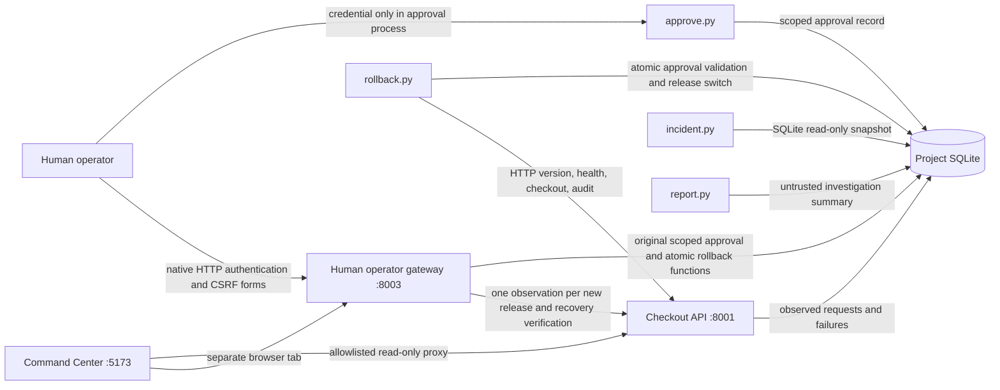

# DeployGuard AI architecture

Implemented local MVP: Python 3.12, FastAPI, Uvicorn, SQLite, HTTPX, and Pytest.
The Incident Command Center adds React/TypeScript, Vite, Tailwind CSS v4, Lucide,
Motion, React Router, and TanStack Query as a separate read-only frontend.
Only the local simulated checkout release is affected. No infrastructure adapter exists.

## Dashboard boundary

The six-page frontend reads `/status`, `/incidents`, `/incidents/{id}`,
`/deployments`, and `/audit` through a fixed loopback proxy. `/version` is also
allowlisted. The proxy rejects browser mutations and excludes `/health` and
`/checkout`; periodic reads therefore do not create observations or incidents.
`GET /status` opens a read-only SQLite snapshot for persisted observations,
deployments, recoveries, and non-credential approval metadata. It never selects
`human_auth` or changes the existing schema.

API connectivity and recorded service health are distinct. With no observation
for the active deployment, the frontend displays Unobserved. Stale evidence is
identified when a refresh fails. No mock records replace unavailable backend data.

Only allowlisted display preferences and an HTTP(S) Mattermost room link persist
locally. Browser JavaScript never reads SQLite or handles the human credential.
Protected browser recovery uses the separate human operator gateway on port 8003,
with native HTTP authentication, script-free HTML forms, exact origin/host checks,
HttpOnly sessions, and rotating CSRF tokens. It calls the original approval and
atomic rollback functions without accepting targets, approval IDs, API destinations,
database paths, or commands from the browser. The frontend only proxies a read-only
gateway availability check; credential-bearing requests never pass through React or
the frontend proxy. CLI recovery remains supported. See
[operator threat model](operator-security.md) and [website demo](dashboard.md).

The gateway startup monitor reads persisted deployment state every two seconds and
issues one actual HTTP health observation for a newly activated release without an
existing observation. Dashboard polling remains pure reads. Automatic detection is
therefore separate from read-only status inspection; it does not fabricate incidents
or accumulate repeated failure observations on each UI refresh.

## Release and evidence model

`runtime` points to one deployment record. Initialization selects healthy `v1.0.0`.
The operator's reset tool selects `v1.1.0`. Each activation gets a unique deployment
ID, even if the version repeats. There are no background probes.

Both health and checkout execute the active release's price configuration parsing.
Healthy configuration parses `2500` cents. Broken configuration actually attempts
`int("invalid-price")`, raising `ValueError`. The error is deliberately simulated;
the HTTP failure, exception, traceback, observation time, and evidence are actually
measured on each request. Health returns 503; checkout returns 500. Every request
observation is stored. Failures log structured evidence to stderr and audit storage.

The incident contains first/last observation times, application, deployment/version,
failure description, latest error evidence, status, and total failed observations.
Full earlier observations and failure audit events remain available. A partial unique
index prevents multiple active incidents for the same deployment. Request execution
and evidence recording share a transaction, so the deployment cannot change halfway
through an observation.

`incident.py` opens SQLite with `mode=ro`, `query_only=ON`, and a snapshot transaction.
It never initializes a database, issues HTTP probes, or records an audit event. Its
status field explicitly identifies persisted observations. `report.py` is a separate
write interface that appends an `investigation_reported` audit event, marked untrusted;
this allows an investigation/recovery audit narrative without making inspection write.

## Approval boundary

A human initializes a verifier before exposing any agent tools. The raw credential
comes only from `DEPLOYGUARD_HUMAN_SECRET` in the approval process. SQLite stores a
random salt and an scrypt digest, not the raw credential. Initialization cannot replace
an existing verifier. The API, investigator, and rollback process do not need this
environment variable, and no endpoint can issue approvals.

An approval has its own ID, incident ID, exact action `rollback`, exact target
`v1.0.0`, creation time, UTC expiration time, and consumption time. Default expiration
is five minutes; allowed TTL is 1–900 seconds. Approval issuance checks the credential
and confirms the incident belongs to the current broken deployment. Approval IDs are
references to existing authorizations, not proof that a human approved in prose.

This is local demonstration authorization, not production identity management.
Filesystem ownership is the root of trust. An agent with unrestricted shell access
under the operator's identity could read/modify code or SQLite, or initialize an
uninitialized verifier. The instruction files do not prevent that. Human initialization
must happen before any agent access, and a real integration needs OS identities,
permissions, an isolated approval service, and auditable identity authentication.

## Atomic recovery and verification

`BEGIN IMMEDIATE` serializes rollback validation and writes. The transaction checks:

1. A persisted approval exists, is unconsumed, and has not expired.
2. Its incident, action, and target exactly match the request.
3. The request is the allowlisted `v1.1.0` → `v1.0.0` transition.
4. The incident is open and belongs to the active deployment instance.

It consumes the approval, writes a deployment and recovery record, switches the
active release, changes the incident to `verifying`, and appends `rollback_executed`
atomically. Any storage error rolls all those changes back. Concurrent use of the
same approval permits only one execution. Denied recovery attempts append a separate
`recovery_rejected` event after rolling back their transaction.

After commit, HTTPX calls `/version`, `/health`, `/checkout`, and `/audit`. Verification
requires version `v1.0.0`, the exact new deployment ID, HTTP 200 and healthy health,
HTTP 200 and successful checkout, the matching rollback audit event, and a final
database check that the deployment has not changed. Only then does the incident
become `resolved`, with a `recovery_verified` audit event. Failure produces
`verification_failed`, a nonzero CLI exit, and `recovery_verification_failed`.
Recovery execution and verification intentionally have separate durable states:
network failure cannot undo the release change or make its consumed approval reusable.
`--verify-only` retries the HTTP checks without another rollback. A reset during checks
cannot revive a superseded incident.

Verification only accepts HTTP loopback on port 8001, disables environment proxies,
and does not follow redirects. No subprocess, shell command, or arbitrary target is
accepted by the recovery implementation.

## Reset and persistence

The reset tool creates a fresh deployment, supersedes active incidents, expires
unused approvals, and appends `demo_reset`. It preserves history and the human
credential verifier. It does not fabricate failures or remove files. Switching from
broken to healthy through reset is blocked; use the approved recovery path instead.

The default database is `evidence/deployguard.sqlite3`. `DEPLOYGUARD_DB` or CLI `--db`
can select another path inside this project. API and tools must use the same path.
SQLite foreign keys, bounded lock waits, and explicit transactions enforce local
consistency. There is no migration system yet. Generated evidence is ignored by Git.

## Demonstrated Switch workflow

The operator manually relayed actual incident evidence to Switch Buddy in Mattermost.
Buddy analyzed the supplied evidence; the human issued approval and ran recovery
locally, then supplied measured verification results for Buddy's final assessment.
All five backend recovery checks passed. Switch is the collaboration surface; this
repository contains no automatic evidence ingestion or autonomous recovery connector.
These live results are operator-reported, separate from the automated suite.

## Prepared specialist-agent integration

The registered `deployguard-investigator` and `deployguard-recovery` remain stopped.
Their planned roles use read-only incident inspection with separate mediated reporting
for investigation, and scoped rollback/verification for recovery. [Agent integration](agent-integration.md)
specifies commands, room handoffs, and required access controls. The [staged demo](demo.md)
orchestrates existing tools and actual local HTTP requests, stopping for separately
issued human approval. It adds no approval or recovery implementation.

This repository supplies instructions and JSON interfaces, not installed Switch
tools or enforced agent restrictions. It does not create/start agents, connect Switch,
alter Switch configuration, or establish isolation. OS/process/filesystem permissions
and mediated tool execution remain operator requirements before startup. Real
infrastructure recovery, monitoring, and production deployment remain outside scope.
